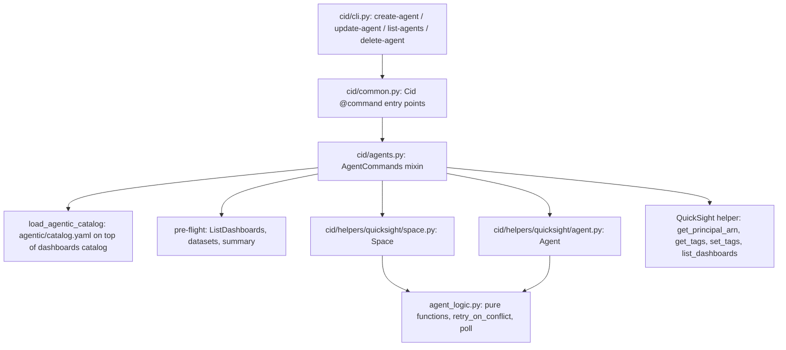

# Design Document: Quick Agents in cid-cmd

## Overview

`cid-cmd` deploys Amazon Quick chat agents over already-deployed Cloud Intelligence Dashboards. Commands: `create-agent`, `update-agent`, `list-agents`, `delete-agent`. Agents and Spaces are catalog content under `agentic/` (see [../agent-standards.md](../agent-standards.md)); no Python change is needed to add one.

Principles:

- **Prerequisite-only.** The agent commands never deploy dashboards, never create datasets and never touch the data layer (CUR, Data Exports, Data Collection). Missing dashboards produce guidance, not deployments.
- **Additive by default.** Nothing added outside the catalog is removed or detached unless `--on-drift override` is passed, and every removal is listed and confirmed first.
- **CID-managed only.** The commands modify or delete only Spaces and agents CID created (provenance tag or description marker).
- **Dashboard commands are unaffected.** They never load the agentic catalog.

## Architecture

## Components

| Module | Role |
|---|---|
| `cid/cli.py` | Click options for the four commands (`--agent-id`, `--space`, `--on-drift`, `--repair`, `--delete-space`) |
| `cid/common.py` | `Cid(AgentCommands)`: four thin `@command` methods; `track()` is reused unchanged |
| `cid/agents.py` | `AgentCommands` mixin: catalog loading, apply flow, pre-flight, picker, override plan, Space resolution, delete |
| `cid/helpers/quicksight/space.py` | `Space`: get (with `spaceArn`), create/update, resources add/remove, owner grant, description marker, delete |
| `cid/helpers/quicksight/agent.py` | `Agent`: describe, create, drift-diffed update, Space attach, repair, delete, waits |
| `cid/helpers/quicksight/agent_logic.py` | Pure logic: caps validation, dependency classification, drift, Space deltas and removals, provenance detection, listing, `retry_on_conflict`, `poll` |

Read the botocore response fields as the model defines them (`spaceArn` at the top level of DescribeSpace, `SpaceResources`, `SpaceSummaries`, `AgentSummaries`); do not guess casing.

## Key decisions

| Decision | Reason |
|---|---|
| Separate agentic catalog, loaded only by agent commands | Dashboard commands stay as before; agent commands also need the dashboards catalog for dashboard ids and dataset definitions. Agents passed via `--catalog`/`--resources` skip the default URL. |
| Spaces own `dashboards`/`datasets`/`knowledgeBases`; agents reference one Space and own action connectors | One definition per Space shared by agents and future flows; Space contents are exactly the Space definition (no merging across agents); sharing a Space never shares actions. |
| Dashboard ids, one `dashboards` list | Matches `deploy --dashboard-id`; required/optional only changed the warning text. |
| `--on-drift show\|override` replaces per-resource sync flags | Same convention as dashboard `update`; one switch between additive and exact; not stored as a default. |
| Pre-flight runs right after the definition is validated | Nothing is created (not even the `cid-owners` group via owner resolution) when no dashboard is deployed; the summary is always shown before any prompt. |
| Owner via `qs.get_principal_arn()` + Author Pro check for users | Same owner resolution as dashboards. |
| Provenance: tag via `qs.set_tags` + description marker | Either signal marks a resource CID-managed; the tag write may be denied independently. |
| No agent parameter store | It inferred an Athena database and wrote `cid_parameters` for a few values. |
| Tracking with the existing `track(action, id)` | `created`/`updated`/`deleted` agent events; the agent id goes in the existing payload field (no backend change). |
| No agent categories | Every agent works as soon as one of its dashboards is deployed; the picker is a flat, searchable list with a one-line `summary`. |
| Personas name dashboard and tab instead of links | Quick does not render dashboard quicklinks reliably. |

## Command flow (create-agent / update-agent)

1. Load the agentic catalog; require Enterprise (read-only check).
2. Resolve the agent (picker when `--agent-id` is omitted) and load its persona; validate caps.
3. **Pre-flight** (read-only): resolve the Space's dashboards against ListDashboards and its datasets against deployed datasets; print the summary; stop when none of the dashboards is deployed.
4. Resolve the owner principal.
5. Existing agent: refuse if not CID-managed; compute drift (and the override plan with `--on-drift override`).
6. Prompt: `update` (create on an existing agent), `confirm-create` (new agent), `confirm-update` (update-agent).
7. Resolve or create the Space (bring-your-own `--space` reuses a Space additively; Spaces that are not CID-managed are never modified); add dashboards, datasets and knowledge bases; apply override removals.
8. Create or update the agent (UpdateAgent has full-replacement semantics: always carry the deployed configuration through); write provenance; `--repair` rewrites Space links; grant owner; wait for ACTIVE; track.

`delete-agent` deletes only CID-managed agents after confirmation, never dashboards; `--delete-space` deletes the agent's Space when no other CID-managed agent uses it, also after the agent is already gone.

## Testing

- `cid/test/python/test_agent_catalog.py`: catalog loading, referential completeness of launch agents and Spaces, Space resource limits, summaries, catalog split.
- `test_agent_command_flows.py`: command flows with mocked helpers (harnesses mock `track` and the `qs` owner and tag helpers).
- `test_agent_helpers.py`: Space and Agent helpers over a mocked boto3 client (patch `cid.helpers.quicksight.agent_logic.time.sleep`).
- `test_agent_logic_properties.py`: property-based tests (hypothesis) of the pure logic.
- `cid/test/bats/30-agents/`: live round trips against a sandbox (self-skipping without credentials).
